# WorkshopService (System service)

<!-- notice:start -->
> **Read before installing.** This plugin runs with real permissions on your machine. Read [SECURITY.md](SECURITY.md) and the section **Permissions and what it changes** below: they say what it can do, which files it writes, and what it sends outside your network (nothing, unless you turn a feature on).

> **The Workshop users and roles do not protect DWC itself.** Anyone who can open DWC on your network can send G-code, move the machine, edit `config.g` and upload files, whatever the Workshop roles say: Duet has no roles of its own. Set a DWC password (`M551`) and keep the machine on a network you trust.
<!-- notice:end -->

WorkshopService is the base of every other workshop plugin. It has two parts: a Python backend that runs on the Raspberry Pi under DSF (central API, database, status LEDs, safety monitors, G-code bridge) and one DWC page, "System service" (`/Plugins/WorkshopService`). Every other plugin depends on it and is installed after it.

Version documented: 2.21.x on DWC 3.6.3.

## 1. Requirements

1. Duet 3 + Raspberry Pi in SBC mode (DSF 3.6). Nothing else is supported (not Duet 2, not without a Pi).
2. DWC 3.6. The release carries one strict zip, `WorkshopService-<ver>-dwc3.6.zip`; the DWC 3.7 line is built but not published yet.
3. DSF 3.6 needs nothing extra for the service.
4. A login user on the Pi that can write `/opt/dsf/plugins`, and SSH from your PC with a key.

## 2. Install (step by step)

1. Pick the zip that matches your DWC line (this machine: DWC 3.6.3, so `-dwc3.6.zip`).
2. From a PC: `tools/install.sh --host <pi> --user <login> --version <ver> --zip <zip> --dry-run` and read the pre-install check (OK / WARNING / ERROR). Fix every ERROR.
3. Wait until the machine is idle (the service is down for some seconds: jog, lights and safety monitors rest).
4. Run the same command without `--dry-run`. On a first install it runs DSF's `PluginManager install`, starts the service and puts `WorkshopService` first in `machine.enabledPlugins`.
5. Reload every DWC tab (and the kiosk). Open *Plugins > System service*.
6. Check the page (picture 1): the header chip "All fine" or the count of problems is plausible, and "Backend started on ..." shows the new time.

Full details: `WorkshopService/docs/INSTALL.md`. Alternative: Settings > Plugins > Install (upload the zip) and then Start; the script is preferred because it also gives owner and execute bit.

## 3. Functions

The page is "System service" (side menu: Plugins > WorkshopService). Its side bar has nine entries: Summary, Processes and automations, G-code bridge, Received commands, Database, Users, Audit, API and keys, DWC password (icons only when collapsed with the double arrow). Red rectangles mark the control described. Addresses, key fragments and device codes are blurred.

### Page header and banner

#### Health chip
- What: the overall state of the service ("With problems: 1" here).
- Where: top right of the page header (any picture).
- How: read only; open the Summary to see what is pending.

#### Banner "Users switched off" and Switch users on
- What: warns that anyone with access to DWC is an administrator while users are off, and offers "Switch users on".
- Where: orange banner under the header (red rectangle, picture 1).
- How: 1. Press "Switch users on". 2. Create the first administrator and give a PIN. 3. Confirm.
- Watch out: it turns the roles on for everybody; you must have a PIN ready. the owner creates users and PINs.

### Summary

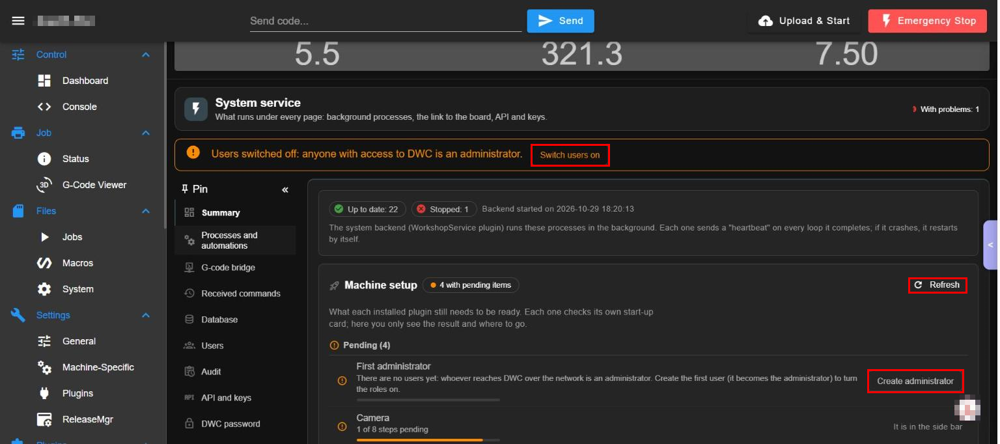

Picture 1: process chips, the card "Machine setup" with "Refresh" and the first pending row with "Create administrator" (red rectangles).

#### Process chips
- What: "Up to date: N" and "Stopped: N" count the internal processes, and "Backend started on ..." gives the start time. The backend runs those processes in the background; each one sends a heartbeat on every loop and restarts by itself if it crashes.
- Where: first card of Summary (picture 1).
- How: read only.

#### Machine setup: Refresh, Pending and Ready
- What: shows what each installed plugin still needs to be ready. Each plugin checks its own start-up card; here you see the result ("1 of 8 steps pending") and where to go.
- Where: card "Machine setup" (picture 1); "Refresh" at its top right.
- How: 1. Press "Refresh". 2. Read the list "Pending (N)". 3. Press the button of a row to go to its card.

#### Create administrator
- What: the first row ("First administrator") says there are no users yet and offers "Create administrator" (the first user becomes the administrator and turns the roles on).
- Where: first pending row (red rectangle, picture 1).
- How: press it and follow the dialog.

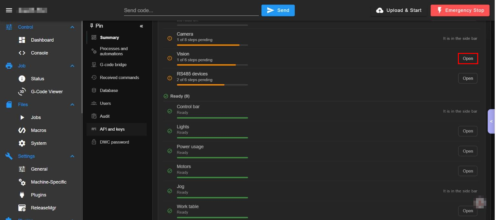

Picture 2: the rest of the list: pending rows with "Open" and the "Ready" group.

#### Plugin rows: Open or "It is in the side bar"
- What: one row per installed plugin with its progress bar and a button "Open" that goes to the page of that plugin's start-up card; Control bar, Jog and Camera say "It is in the side bar" because their card is in the floating panels.
- Where: picture 2.
- How: press "Open" (red rectangle).

#### Black box notice and Communication with the Duet
- What: below the list: the black box notice ("The system shut down without closing") when the last shutdown was not clean, with the last data saved, the most probable cause, the last minutes of CPU / memory / temperature, a "Download" button and "Hide" (it stays until you press Hide). The card "Communication with the Duet" shows which Duet channel each kind of code uses (service codes: automatic Aux2 / Aux / SBC, the first free; Jog: SBC or other); channels that belong to the firmware (HTTP, Telnet, File, Daemon...) show "Cannot be chosen".
- Where: bottom of Summary (appear only when they apply; not in the pictures).
- How: press "Download" to save the report, "Hide" to remove the notice.

### Processes and automations

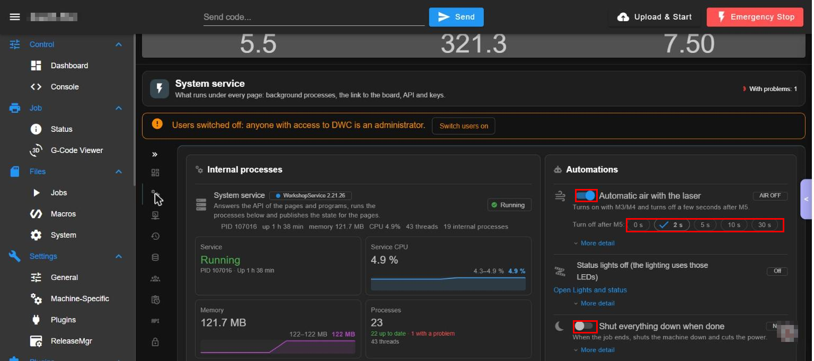

Picture 3: "Internal processes" at the left and "Automations" at the right (red rectangles on the M5 times and the two switches).

#### Internal processes
- What: the main process (version, PID, uptime, memory, CPU, threads) with cards Service, Service CPU, Memory and Processes (relaunched / errors / protections with small charts), and below one row per internal process with its state, last heartbeat and restarts. A process that falls is restarted by itself.
- Where: left card (picture 3).
- How: read only. A module rests when the plugin that needs it is stopped; each process has a mode Auto / Always / Never (safety modules ignore Auto rest: only an explicit Never stops them).

#### Automatic air with the laser
- What: turns the air on with M3/M4 and off a few seconds after M5; "Turn off after M5" chooses 0 s, 2 s, 5 s, 10 s or 30 s (default 2 s). The chip shows the state of the air now ("AIR OFF").
- Where: first automation (red rectangle, picture 3).
- How: 1. Press the switch. 2. Choose the delay.
- Watch out: it needs the air macros of the Control bar. "More detail" unfolds the explanation.

#### Status lights (automatic) and link to Lights
- What: shows whether the automatic status lights are on (here "Off": the lighting uses those LEDs) and the link "Open Lights and status".
- Where: second automation (picture 3).
- How: press the link to change it in Lights.

#### Shut everything down when done
- What: when the job ends, shuts the machine down and cuts the power. Default NO.
- Where: third automation, with its switch (red rectangle, picture 3).
- How: press the switch to arm it.
- Watch out: if you leave it on, the machine powers off at the end of the next job.

#### Machine movement
- What: the fourth automation, a switch about the movement of the machine (see its "More detail").
- Where: right card, below the shut down switch (scroll down).
- How: press "More detail" to read what it does before changing it.

### G-code bridge

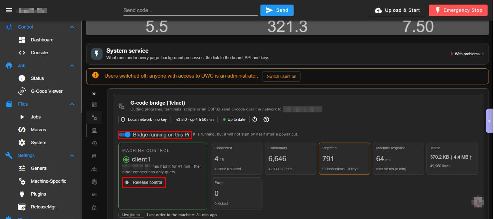

Picture 4: the bridge title, chips, "Bridge running on this Pi" and "Machine control" with "Release control" (red rectangles). The address is blurred.

#### Bridge status chips
- What: "Local network - no key" (or key required), version and uptime, "Up to date", a restart icon and a help icon. The bridge is for programs that send live G-code over the network (laser / CNC programs, scripts, an ESP32); the title shows the address of the Pi and port 23.
- Where: top of the card (picture 4).
- How: the help icon opens the explanation.

#### Bridge running on this Pi
- What: starts or stops the bridge; it starts by itself but "will not start by itself after a power cut" when it is shown that way.
- Where: switch under the chips (red rectangle, picture 4).
- How: press the switch.
- Watch out: stopping it cuts every connected program.

#### Machine control and Release control
- What: only one connection has control (the first that sends an order keeps it); the others only query. The card shows who has it and for how long; "Release control" lets go.
- Where: green card "MACHINE CONTROL" (red rectangle, picture 4).
- How: press "Release control" to free it.
- Watch out: it can cut a program in use.

#### Counters and last hour chart
- What: Connected (n / max), Commands, Rejected, Machine response, Traffic, Errors; below, the chart "Last hour (per minute)" of commands, queries and rejections.
- Where: tiles right of the control card (picture 4) and the chart at the top of picture 5.

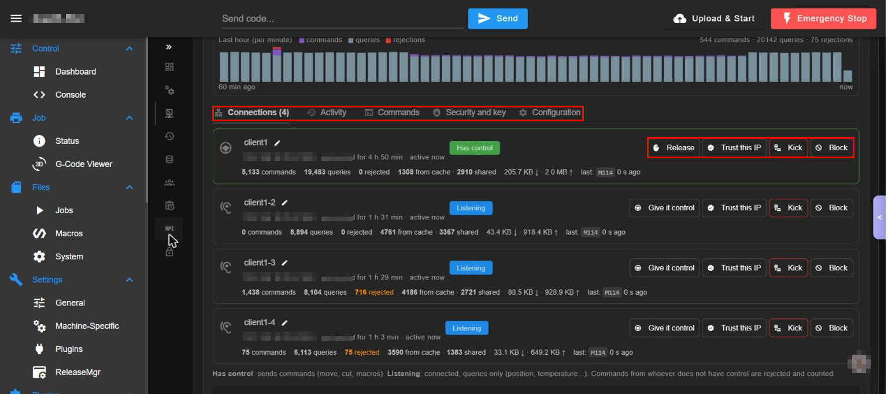

Picture 5: the tabs Connections, Activity, Commands, Security and key, Configuration (red rectangle) and the buttons of each connection (second red rectangle). Addresses are blurred.

#### Connections: Give it control, Release, Trust this IP, Kick, Block
- What: one row per program: name (the pencil renames it), address, time connected, counters and the last command; the badge "Has control" or "Listening". Buttons: "Release" / "Give it control" moves the control; "Trust this IP" puts the address in the trusted list; "Kick" disconnects it; "Block" refuses it.
- Where: tab "Connections" (picture 5).
- How: press the button of the row.
- Watch out: Block and Kick cut a working program.

#### Tabs Activity, Commands, Security and key, Configuration
- What: Activity: the log of connections; Commands: the commands received; Security and key: trusted IPs and the key (`BRIDGE KEY <key>`); Configuration: maximum connections (default 8), a single connection with control (exclusive), wait for the board to accept a line, "queries in job", the welcome with help and the lines to paste in the program's device settings.
- Where: tab row (red rectangle, picture 5). They are not in the pictures because they show addresses and the key.
- How: press a tab.

### Received commands

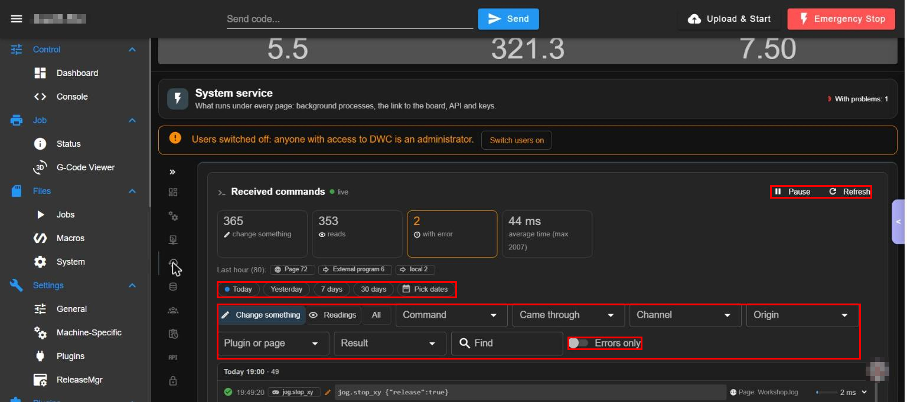

Picture 6: the live log header, counters, period buttons and filters (red rectangles).

#### Live log: Pause and Refresh
- What: a live record of every API call; "Pause" freezes it and "Refresh" reads it again.
- Where: top right of the card (red rectangle, picture 6).
- How: press Pause or Refresh.

#### Counters and origins
- What: change something, reads, with error and average time; "Last hour" origins (Page, External program, local).
- Where: tiles under the title (picture 6).

#### Period and filters
- What: Today, Yesterday, 7 days, 30 days, Pick dates; filters "Change something", "Readings", "All", Command, Came through, Channel, Origin, Plugin or page, Result; search "Find" and the switch "Errors only".
- Where: red rectangles in picture 6.
- How: press a period, choose the filters and type in "Find".

#### Command rows
- What: each row shows the time, the operation, its parameters, who made it (user and role) and the duration; the arrow opens the detail.
- Where: list under the filters (bottom of picture 6).

### Database

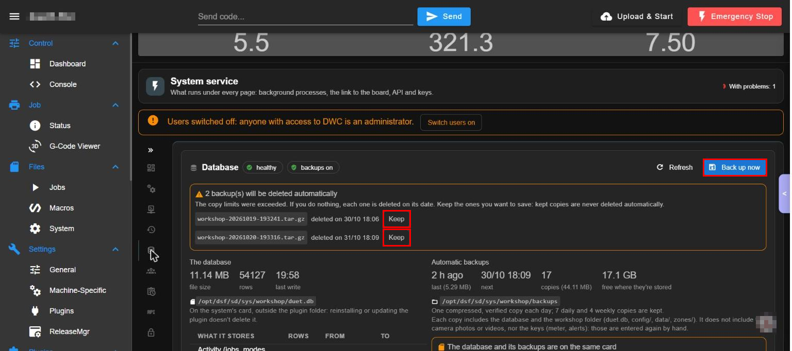

Picture 7: state chips, "Refresh", "Back up now" and the "Keep" buttons (red rectangles).

#### Database state and tables
- What: the SQLite file `/opt/dsf/sd/sys/workshop/duet.db` (chips "healthy" and "backups on"): size, rows, last write, and the table list (Activity, audit, Received commands, consumption, health) with rows and first date.
- Where: left column of the card (picture 7; the table list is below).
- How: read it; "Refresh" reads again.

#### Automatic backups and Back up now
- What: one compressed, verified copy each day; 7 daily and 4 weekly copies are kept (the oldest are deleted by age). The card shows the last, the next, the number of copies, their size and the free space. "Back up now" makes one at once. It does not include the camera photos or videos nor the keys (meter, alerts): those are entered again by hand.
- Where: right column and the blue button at the top right (picture 7).
- How: press "Back up now".
- Watch out: The note "The database and its backups are on the same card" means that if the card fails both are lost: connect a USB drive to copy them.

#### Keep a backup that will be deleted
- What: the orange warning lists the backups that will be deleted automatically and when; "Keep" protects one: kept copies are never deleted automatically.
- Where: orange box (red rectangles, picture 7).
- How: press "Keep" beside the copy you want to save.

#### Configuration package: Export and Import
- What: exports the page settings, work zones, macros and machine modes to a file; imports one. It never includes users, PINs, keys or the database. Imported machine modes go to `sys/workshop/imported/` to be read, never applied.
- Where: lower in the Database section (scroll down; not in the picture).
- How: 1. Press Export to save a file. 2. Press Import and choose a file to load it.
- Watch out: Export downloads a file.

### Users

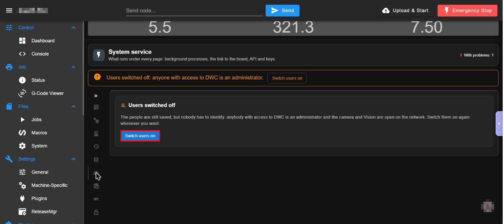

Picture 8: the card "Users switched off" with "Switch users on" (red rectangle).

#### Switch users on
- What: with users off the people are still saved but nobody has to identify: everybody is administrator and the camera and Vision stay open on the network. "Switch users on" asks for a PIN.
- Where: Users, the card (picture 8).
- How: press the button and follow the dialog.
- Watch out: same as the banner.

#### People, roles and PINs (with users on)
- What: with users on the card lists the people (name, role, PIN of 4 or more digits, reset PIN, close sessions), the modes an operator may use (default laser only), camera for viewers, "anonymous viewer" for the touch screen (view only) and the session length (never expires, or limits).
- Where: Users, when users are on (not in the pictures: they show names and PINs).
- How: choose a person and use the buttons of its row.
- Watch out: administrator only.

### Audit

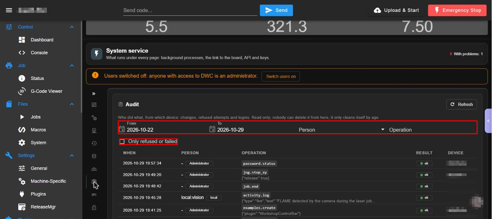

Picture 9: the audit list with the filters (red rectangles); the device column is blurred.

#### Audit list and filters
- What: who did what, from which device: changes, refused attempts and logins. Filters: From, To, Person, Operation and the tick "Only refused or failed"; "Refresh" reads again. Read only: nobody can delete it from here, it only cleans itself by age.
- Where: Audit (picture 9).
- How: choose the dates and filters.

### API and keys

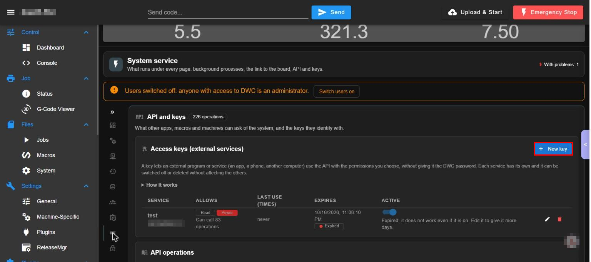

Picture 10: "Access keys (external services)" with "New key" (red rectangle); the key text is blurred.

#### Access keys: New key, edit, switch and delete
- What: a key lets an external program (an app, a phone, another computer) use the API with the permissions you choose, without giving it the DWC password. Each service has its own and can be switched off or deleted. The list shows the service, what it allows (classes Read, Change, Move, Stop, Energy, Power), the last use, the expiry (an expired key does not work even if it is on) and the Active switch; the pencil edits and the bin deletes.
- Where: card "Access keys" (picture 10).
- How: 1. Press "New key". 2. Name the service, choose the classes and the expiry. 3. Save and copy the key now.
- Watch out: A key is like a password; do not share it or its pictures.

#### API operations reference
- What: the list of every API operation by category (here 226 operations), with the operations patterns used by the keys.
- Where: card "API operations" below the keys (bottom of picture 10).
- How: open a category to read its operations.

### DWC password

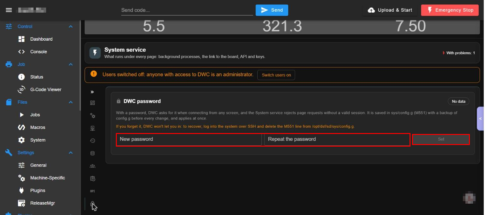

Picture 11: the two password fields and "Set" (red rectangles).

#### Set the DWC password
- What: shows whether DWC has a password (M551); with one, DWC asks for it when connecting from any screen and the service rejects page requests without a valid session. It is saved in `sys/config.g` as an `M551 P"..."` line (that is how RepRapFirmware keeps it: there is no other place) and applies at once. Before every change the service copies `config.g` to `config.g.bak-password-<date>` WITHOUT the password (the M551 line is commented out in the copy), so the backups do not pile up old passwords; restoring such a copy leaves DWC without a password.
- Where: DWC password (picture 11).
- How: 1. Type the password twice. 2. Press "Set".
- Watch out: if you forget it DWC will not let you in: log into the system over SSH and delete the M551 line from `/opt/dsf/sd/sys/config.g`. Without a password anyone on the network controls the machine. The DWC password is a door for casual visitors, not strong security: it is stored as plain text in `config.g` (readable by whoever can read the SD card or the file area of DWC once logged in) and travels unencrypted over plain HTTP on your network. For real control use the users with PIN of this page (the PIN is stored only as a hash and the roles are applied in the server).

## 4. Settings

| Setting | Where | What for | Default | If wrong |
|---|---|---|---|---|
| Air auto with laser, "turn off after M5" | Processes | Air assist follows M3/M4 and stops after M5 | on, 2 s | 0 s cuts air at once; too long wastes air |
| Shutdown after job | Processes | Powers the machine off at the end | off (NO) | on by mistake powers off after every job |
| Process mode Auto/Always/Never | Processes | Force a module on or off | Auto | Never on a safety module removes protection |
| Bridge active, key, trusted IPs, max connections, exclusive | Bridge | Live G-code over Telnet | active, no key, 8, exclusive | see 3.3 |
| Backups | Database | Daily backup, retention | on | Without it a card failure loses history |
| Users / roles | Users | PIN login | off | off = everybody admin |
| Duet channel for service codes / Jog | Summary | Which channel carries service G-code | automatic | A busy channel delays lights and reads |

Settings live outside the plugin folder: `0:/sys/workshop/config/service.json`, `/opt/dsf/conf/workshop-secrets.json`, `/opt/dsf/conf/workshop-users.json` (mode 600). Uninstalling the plugin does not delete them.

## 5. Roles and permissions

Four roles, applied in the server for every API operation (`dsf/permissions.py`): Viewer (looks), Operator (moves and runs jobs in allowed modes), Technician (settings, mode change), Admin (everything, users, power). Without users everybody who reaches DWC is admin, but the camera relay, Vision and the G-code bridge only let the network look (reads and queries); the first user created turns roles on. Token header `X-Workshop-Token`. The page shows a "read only" chip when your role can only look.

## 6. API operations used

The page uses `POST/GET /machine/WorkshopService/api`: `api.describe`, `capabilities.get`, `profile.get/set`, `preflight.run`, `settings.get/set/merge`, `users.*`, `audit.*`, `activity.*`, `db.*` (backup), `bridge.*`, `guard.status/set`, `keys.*`, `health.*`. Full table: `WorkshopService/docs/api/README.md` and the API section of the page.

## 7. Troubleshooting

1. Page says "The system service is missing" or "The system service is stopped": start WorkshopService in Settings > Plugins (stop Vision and RS485 first if Stop does nothing).
2. Plugin shown as "partially started" with only Stop: press Stop, then Start; last resort add the id to `machine.enabledPlugins` (PUT as `application/octet-stream`).
3. Other plugins fail with "depends on WorkshopService which is not loaded": WorkshopService must be first in `machine.enabledPlugins`.
4. After installing check that `machine.enabledPlugins` still lists your plugins (DWC 3.6 drops one that failed to load); reload every tab.
5. "This Duet is not in SBC mode": the base is not supported.
6. Check `journalctl -k | grep DENIED | grep Workshop` for AppArmor denials.

<!-- permissions:start -->

## Permissions and what it changes

Risk: **High (backend with broad permissions; it can shut the system down)**. Read this before installing; the full document is `security.md` of the Workshop plugins.

**DSF permissions** (DSF shows them and you approve them when you install; the zip asks for nothing else):

| Permission | What it lets the plugin do | Where the code uses it |
|---|---|---|
| `commandExecution` | send G-code to the board | G-code through `CommandConnection`: `dsf/jog_move.py` (jog moves), `dsf/status_light.py` (`M150` LEDs), `dsf/machine_ops.py`, `dsf/machine_workarea.py`, `dsf/machine_height.py`, `dsf/frame_ops.py` (Machine page actions, only the closed list of `dsf/machine_gcode.py`), `dsf/main.py` |
| `codeInterceptionReadWrite` | intercept G-code (M3/M4/M5, a device fault) and let it through or change it | `dsf/main.py` (`InterceptConnection`, `M3`/`M4`/`M5` for the air assist and the live-job activity), `dsf/bed_zones_intercept.py` (`M140`/`M190` for bed zones) and `dsf/jog_move.py` (a lock that blocks motion codes while a jog runs) |
| `objectModelReadWrite` | read the state of the machine and publish its own data in it | `dsf/machine_state.py` (one subscription to the model) and `dsf/publisher.py` (`set_plugin_data` of the plugin's own data) |
| `networkAccess` | open network connections (notices, the meter, the camera, the service API) | listens: the camera relay `dsf/camera_relay.py` (port 8090, `camera_relay.bind`) and the optional G-code bridge on port 23 (its own process); connects: the LAN (cameras, the Tuya meter in `dsf/tuya_meter.py`), DSF on `localhost`, and `ntfy.sh` only when you turn the phone notices on (`dsf/notifier.py`) |
| `registerHttpEndpoints` | answer on its own address (an API endpoint under /machine/<Id>/) | `dsf/workshop_api.py`: `/machine/WorkshopService/api` (POST and GET) |
| `writeSystem` | lock files under 0:/sys (the history database needs it) | SQLite file locks in `0:/sys/workshop/data/duet.db` (`dsf/db.py`); measured with `tools/permission_probe.py`: without it every API call is HTTP 500 |
| `fileSystemAccess` | read and write files outside the DSF folders (keys, camera files) | `/opt/dsf/conf/workshop-secrets.json`, `workshop-users.json`, `workshop-roles.json`, `workshop-api-token`, `workshop-camera.key` (`dsf/paths.py`, `dsf/config_store.py`, `dsf/users.py`, `dsf/role_store.py`, `dsf/api_ops.py`, `dsf/camera_key.py`); camera files in `/opt/dsf/sd/workshop/camera/` (`dsf/camera_*.py`); reads of `/proc` and `/sys/class/thermal` (`dsf/health_poller.py`, `dsf/cpu_meter.py`); the LED SPI device named in DSF's `config.json` (`dsf/pi_leds.py`). Measured: without it every call is 401. It could not be narrowed: the files are outside the folders the narrower permissions cover (unverified: DSF's list of folder permissions was not checked on the machine) |
| `launchProcesses` | start programs (ffmpeg, pinctrl, systemctl, sudo shutdown) | `ffmpeg` (`dsf/camera_assembly.py`, `dsf/camera_timelapse.py`, `dsf/camera_notice.py`), `pinctrl` (`dsf/pi_leds.py`), `vcgencmd`, `ip`, `nmcli`, `ping`, `systemctl`, `journalctl` (`dsf/health_poller.py`), `systemctl` for the bridge unit (`dsf/bridge_service.py`), `sudo -n shutdown` / `sudo -n reboot` (`dsf/handlers/shutdown_all.py`, `dsf/handlers/reset_all.py`). Measured: without it `exec` of `ip` and `vcgencmd` is denied. DSF has no per-program permission |

**Runs a program on the Pi:** `main.py` as the `dsf` user (restarted by DSF if it stops).

**Files it writes:**
- `0:/sys/workshop/` (settings, data, history database `duet.db`, macros it generates, work zones, backups)
- `/opt/dsf/conf/workshop-secrets.json` and `workshop-users.json` (mode 600), `workshop-camera.key`

**What it needs outside the zip** (each one is a separate step you do on purpose and can undo):
- Internet access to `ntfy.sh` (or your own ntfy server) from the Pi, only if you turn the phone notifications on (off by default, see the safety notes)
- `/etc/sudoers.d/dsf-power`, only if you want the shutdown / restart buttons: you create it by hand (steps below)
- the G-code bridge (`sudo bridge/install.sh`): systemd unit, polkit rule and `/opt/workshop-bridge`; `sudo bridge/install.sh uninstall` removes them
- ports: the camera relay (8090 by default, all interfaces; `camera_relay.bind` keeps it on the Pi) and the G-code bridge (23)
- `ffmpeg` for timelapses and snapshots; `tinytuya` for a Tuya energy meter
- the `kiosk/` helper scripts of the touch-screen Pi, only if you copy them to your home folder (table below); they are not in the zip
- `sudo tools/uninstall-system-rules.sh` removes the sudoers rule again (and, with `--bridge`, the bridge)

**How to: the shutdown / restart rule (sudoers)**

1. On the Pi run `sudo visudo -f /etc/sudoers.d/dsf-power` and write this single line, then save:
   `dsf ALL=(root) NOPASSWD: /usr/sbin/shutdown, /usr/sbin/reboot`
2. Check the syntax: `sudo visudo -c` (it must report that the files parsed OK). Check what `dsf` may run: `sudo -l -U dsf`.
3. Test without shutting down: `sudo -u dsf sudo -n -l /usr/sbin/shutdown` prints the path when the rule works and an error when it does not. The real test is the *Shut down now* button, which powers the Pi off.
4. Undo: `sudo rm /etc/sudoers.d/dsf-power`. Without the file those buttons log an error and the system keeps running.

**How to: the G-code bridge**

1. From the `bridge` folder of the WorkshopService sources, on the Pi: `sudo ./install.sh` (the same command updates it later). It copies the code to `/opt/workshop-bridge`, writes and starts the unit `workshop-gcode-bridge.service` and writes the polkit rule `49-workshop-gcode-bridge.rules`, which lets the `dsf` user start and stop only that unit.
2. Check: `systemctl status workshop-gcode-bridge`, or the "G-code bridge" section of the System service page.
3. Undo: `sudo ./install.sh uninstall` removes the unit, the rule and `/opt/workshop-bridge` (your data in `0:/sys/workshop` stays); `sudo ./install.sh no-control` removes only the polkit rule (the page can then no longer start or stop the bridge).

**About AppArmor**

- DSF writes the profile `/etc/apparmor.d/dsf.<PluginId>` from the manifest when the plugin is INSTALLED, not when it is only reloaded or restarted. The permissions you approve in DWC become its lines (details and measurements: `docs/PERMISSIONS.md` of the WorkshopService repository).
- To see whether it blocks something: `journalctl -k | grep DENIED | grep Workshop` (no output means no denial).
- If the profile is old or a feature is denied after an update that changed the permissions, install the plugin again from DWC so DSF rewrites the profile, then check the command above once more.

**How to: the `kiosk/` scripts**

They are in the WorkshopService source repository, NOT in the zip: installing the plugin never copies them. You copy the ones you want to your home folder on the kiosk Pi; they run as your login user, not as `dsf`, and none of them needs `sudo` except `chromium-no-zoom` (to install it) and `capture.sh`.

| Script | What it does | What it writes | How it starts | Remove |
|---|---|---|---|---|
| `ensure-emergencyfab.sh` | puts back into `machine.enabledPlugins` of `0:/sys/dwc-settings.json` the plugins DWC dropped, only when no screen has DWC open; skips plugins you stopped on purpose | that file, through DSF's file API on `http://localhost`; its log `~/ensure-emergencyfab.log` | line in `~/.config/labwc/autostart` | delete the line and the files |
| `keyboard-watchdog.sh` | starts the on-screen keyboard (squeekboard) when a touch screen exists and it is not running | nothing | `~/.config/labwc/autostart` | delete the line |
| `wifi-watchdog.sh` | keeps the Pi on the saved Wi-Fi profile `DUET`: switches the radio on, deletes duplicate profiles named `DUET <n>`, brings `DUET` up (`nmcli`) | NetworkManager connections | `~/.config/labwc/autostart` | delete the line (the profile named in `PROFILE` is not removed) |
| `display-watchdog.sh`, `touch-unlock.sh` | take the black lock layer (`swaylock`) away with `SIGUSR1` after the touch controller re-enumerates or the screen is touched; they never kill it | nothing | `~/.config/labwc/autostart` | delete the lines |
| `screensaver-on.sh`, `screensaver-off.sh` | the idle screensaver: put up and take away the black `swaylock` layer | `/tmp/duet-ss.pid` (removed) | called by `swayidle` | remove them from the `swayidle` command |
| `kiosk-osk.py` | shows / hides the keyboard when the page asks, over D-Bus | nothing; listens on `127.0.0.1:8099` only | `~/.config/labwc/autostart` | delete the line |
| `kiosk-three-fingers.py` | closes the kiosk browser (`pkill -f app=http://localhost`) when the screen is tapped with three fingers at once | nothing | `~/.config/labwc/autostart` | delete the line |
| `chromium-shim.sh` | runs Chromium with `--autoplay-policy=no-user-gesture-required` so DWC can beep | nothing | copied as `~/kiosk-bin/chromium`, put first in `PATH` of the autostart | delete `~/kiosk-bin/chromium` and the `PATH` part |
| `chromium-no-zoom` | adds `--disable-pinch` to Chromium | `/etc/chromium.d/98-no-zoom` (needs `sudo`) | read by Chromium's launcher | `sudo rm /etc/chromium.d/98-no-zoom` |
| `capture.sh` | diagnostic for the G-code bridge: records port 23 with `tcpdump` until you press Ctrl+C | `/tmp/live_job.pcap` (needs `sudo`) | by hand only | nothing to remove |

**How to: remove everything the Workshop set added outside the zip**

Uninstalling a plugin from DWC removes only its own folder. This is everything else, in the order to do it. The last two rows DELETE YOUR DATA and cannot be undone: export the history and take a backup first.

| What | Command | Deletes your data? |
|---|---|---|
| The plugins | in DWC *Settings > Plugins*, or `PluginManager uninstall <Id>`: the plugins that depend on `WorkshopService` first (stop Vision and RS485 before), `WorkshopService` last | no |
| The AppArmor profile DSF wrote at install (`/etc/apparmor.d/dsf.<Id>`) | check `ls /etc/apparmor.d/dsf.*`; if one is left after uninstalling, `sudo apparmor_parser -R /etc/apparmor.d/dsf.<Id> && sudo rm /etc/apparmor.d/dsf.<Id>` (unverified: whether DSF removes it by itself) | no |
| The shutdown / restart rule | `sudo tools/uninstall-system-rules.sh` (add `--dry-run` to only list); by hand: `sudo rm /etc/sudoers.d/dsf-power` and then `sudo visudo -c` | no |
| The G-code bridge: unit, polkit rule, `/opt/workshop-bridge` | `sudo bridge/install.sh uninstall` (or `sudo tools/uninstall-system-rules.sh --bridge`) | no |
| The kiosk helpers | the table above: delete their lines from `~/.config/labwc/autostart`, the copies in your home folder, `~/kiosk-bin/chromium`, and `sudo rm /etc/chromium.d/98-no-zoom` | no |
| Keys, users, roles, API token, camera key | `sudo rm /opt/dsf/conf/workshop-secrets.json /opt/dsf/conf/workshop-users.json /opt/dsf/conf/workshop-roles.json /opt/dsf/conf/workshop-api-token /opt/dsf/conf/workshop-camera.key`. A new install makes a NEW camera key: an ESP32-CAM flashed with the old one stops authenticating | **yes** |
| Settings, history database, zones, macros and camera files | `sudo rm -rf /opt/dsf/sd/sys/workshop /opt/dsf/sd/workshop`, and `/opt/dsf/sd/sys/workshop-model-agent` and `/opt/dsf/sd/sys/workshop-globals.g` if you used Model Explorer | **yes** |

Changes you made through the pages to your own files (`config.g` LED count from Lights, the mode files from Printing) keep a `.bak` next to them; uninstalling does not revert them.

**Safety notes:**
- **No users: the network can only look.** Until the first administrator exists, the camera relay (8090), Vision (8095) and the G-code bridge (23) answer reads and queries from the network but refuse everything that changes something (the camera settings, calibration, G-code orders); only the Pi itself is not limited. Whoever reaches DWC is still an administrator (a DWC password is the protection there), so create the first administrator in the Users section. If you switch the roles off on purpose (with an administrator's PIN), the relay and Vision are open to the network again. A bridge without a password, an allowed list or a trusted address refuses every order: `install.sh` asks for one.
- **Nothing leaves your network by default.** Phone notifications (ntfy) are OFF until you turn them on in the Activity page, which asks you to confirm. Once on, event texts (job end, job pause, errors, Pi health, power) go to a third-party server, `https://ntfy.sh` unless you set your own, and a camera photo or short video is attached when the camera is configured and the type's attachment is set. Anyone who knows the random topic can read them, so keep it private. While they are on, the Pi also sends a `HEAD` request to that server to measure latency. Turn them off to stop all of it.
- The Pi health page pings a public address (`1.1.1.1`) for its "internet" latency only if you set `health.internet_check` to `true` in the service settings; it is off by default.

Uninstalling removes the plugin folder; your data in `0:/sys/workshop/` and `/opt/dsf/conf/workshop-*.json` stays.

<!-- permissions:end -->

## 8. Limits

Duet 3 + Pi only. A plugin update of the service is made by copying files (never `PluginManager install` over it). No custom G-code codes: everything goes through the API. Install with the machine idle.

## 9. Update, rollback and uninstall

Update: same `install.sh` (it backs up to `~/sd-backup/WorkshopService-pre-<ver>`). Rollback: `tools/install.sh ... --rollback <ver>`. Uninstall: first every dependent plugin, the service last (`PluginManager uninstall <Id>`); your data stays in `0:/sys/workshop`. See ../README.md.

